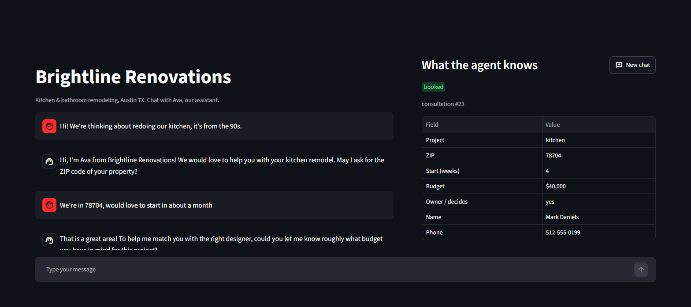
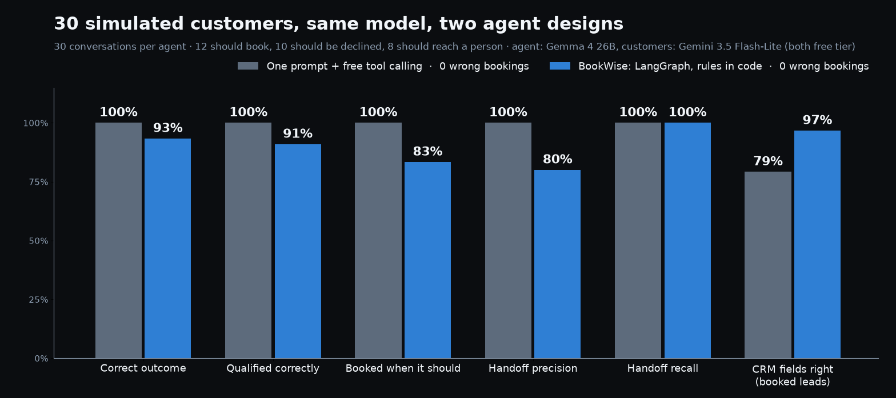
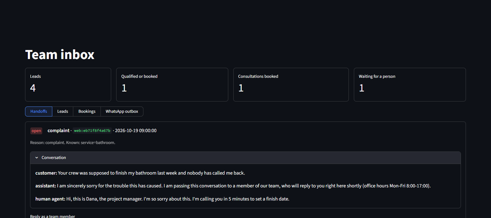

# BookWise — a sales chat agent that qualifies leads, books consultations and knows when to call a human

A prospect writes in the web chat (or on WhatsApp). The agent asks the qualifying questions a good salesperson would ask (what project, where, when, what budget, who decides), declines politely when the lead doesn't fit, books a free consultation when it does, writes everything to the CRM, and hands the conversation to a person when it should: complaints, angry customers, discount or contract questions, reschedules, or when it can't follow.



> The business, Brightline Renovations (kitchen and bathroom remodeling, Austin TX), is fictional. Calendar, CRM and WhatsApp are mocks behind clean interfaces, so Google Calendar, HubSpot or the WhatsApp Cloud API can be plugged in without touching the agent.

## Results

Measured with 30 simulated customers, each labelled with the outcome the business's own rules call for: 12 should get a consultation (easy, rambling, typos, Spanish, asks questions first, afternoons only, Thursday/Friday only, corrects their budget, exactly at the minimum budget...), 10 should be declined politely (budget too low, Dallas, renter, parents' house, roof, deck, next year, a prompt-injection attempt...), 8 should reach a person (complaint, angry, wants a human, discount, warranty claim, contract, reschedule, won't give a budget).

The agent is **Gemma 4 26B**; the customers are played by **Gemini 3.5 Flash-Lite** with a role prompt per persona (both free tier). Every outcome is read from the database (bookings, CRM, handoff queue), never judged by a model. Clock frozen at Monday 2026-10-19 09:00. One run per agent; `eval/results/` has every conversation.

| | One prompt + free tool calling | **BookWise graph** (rules in code) |
|---|---|---|
| Correct outcome | **30/30 (100%)** | 28/30 (93.3%) |
| Wrong bookings (unqualified lead, or a time the customer said they can't do) | **0** | **0** |
| Booked when it should | 12/12 | 10/12 |
| Handoff recall / precision | 100% / 100% | 100% / 80% |
| CRM fields exactly right, on booked leads | 57/72 (79%) | **58/60 (97%)** |
| Model calls per conversation | 6.5 | 7.3 |
| Wall time for 30 conversations (8 in parallel) | ~27 min | ~8 min |



### What the measurements taught

- **The simple design was the more accurate one here.** With a capable model, one prompt with the rules and four tools reached the right outcome for all 30 customers. The graph's two misses were unnecessary handoffs: a customer who stated a hard budget limit and asked "is that enough?" was read as asking for a negotiation, so a person was called in.
- **The graph's advantage is the data and the guarantees.** It writes the CRM in code on every turn, so booked leads arrive complete (97% of fields exactly right). The tool-calling agent writes the CRM only when the model decides to call `save_lead`, and it often left fields out (79%). And in the graph the sales policy is a pure, unit-tested function (`app/business.py`): no model output can book a lead that fails it.
- **Text beats the model's numbers.** During development the model once answered "Option 2, Wednesday at 1 PM" with slot 1 and booked the wrong morning, read "Wednesday Oct 21 at 9" as a $21 budget, and read the last digits of a phone number as a budget. Each became a small deterministic check with tests: the time the customer wrote wins over the model's slot number, a budget or ZIP must actually appear in the message, phone numbers are parsed by code.
- **Free tiers shape the engineering.** Gemini's free tier allows 500 requests a day per model, NVIDIA NIM cut bursts with 429s and dropped most of its models during the runs. The evaluation therefore caches every call, replays a conversation from the cache after an outage, and never scores a provider error as an agent decision.

## How it works

The main design choice: **the LLM reads and writes, code decides.** A LangGraph state machine runs once per customer message:

```
customer message (web chat / WhatsApp webhook)
   │
   ▼
understand ── LLM with structured output: intent, sentiment, confidence and every fact
              in the message (service, ZIP, budget, start date, owner?, name, phone, chosen time)
   │
   ▼
decide ─────── plain Python, unit tested:
   │           1. handoff rules (complaint, asks for a person, quote/discount/contract/warranty,
   │              reschedule, angry, two unclear messages in a row)
   │           2. sales policy (app/business.py): service offered? ZIP in area? start within
   │              12 weeks? budget ≥ minimum for that service? owner who decides?
   │           3. next missing fact, or contact details, or a time
   ▼
one action ─── ask │ offer_slots │ book │ disqualify │ handoff │ follow_up
   │           (only these nodes touch the calendar, the CRM and the handoff queue)
   ▼
respond ────── LLM writes the message, told exactly what to say
```

So the model can't book a lead that failed the rules, invent a free slot, or skip a handoff, however the customer phrases things (prompt injection included). The database refuses double bookings on its own (a partial unique index). The graph state — facts so far, slots on the table, retry counters — is checkpointed in SQLite per conversation, so a restart doesn't lose a half-qualified lead.

For comparison, the repo also has the way most booking-agent demos are built: **one prompt with the rules + free tool calling** (`app/agents/baseline_agent.py`). It uses the same calendar, CRM and handoff tools and the same model; only the design differs. The evaluation runs both against the same simulated customers.

| Part | File |
|---|---|
| Business rules (the whole sales policy, pure function) | `app/business.py` |
| LangGraph agent: nodes, `decide()`, slot matching | `app/agents/graph_agent.py` |
| Baseline agent: one prompt + native tool calling | `app/agents/baseline_agent.py` |
| Ports (Calendar, CRM, Handoff, Channel) | `app/ports.py` |
| SQLite implementations + transcripts | `app/store.py` |
| Web chat / WhatsApp entry point, human takeover | `app/service.py`, `app/channels.py` |
| HTTP API (FastAPI) | `app/api.py` |
| Chat screen + team inbox (Streamlit, talks only to the API) | `ui/` |
| LLM providers: Gemini, Claude, NVIDIA NIM | `app/llm.py` |
| Simulated-customer evaluation | `eval/personas.py`, `eval/run_eval.py` |

### Human handoff

When the agent hands off, it opens a ticket with the reason and what it knows, tells the customer a person will reply in the same chat, and **stops answering**. The team sees the queue in the inbox, replies inside the conversation (on WhatsApp the reply goes out through the channel), and gives it back to the bot when done.



### WhatsApp-ready

`POST /webhook/whatsapp` accepts the WhatsApp Cloud API webhook format (and `GET` answers Meta's verification handshake). Replies go through a `ChannelPort`: the mock keeps the exact JSON it would POST to `/{phone-number-id}/messages`; `WhatsAppCloud` in `app/channels.py` sends it for real once a Meta app, phone number id and token exist (not tested against Meta here).

## Run it

You need Docker and a free Gemini API key (https://aistudio.google.com/apikey). The default model is Gemini 3.5 Flash-Lite; `LLM_MODEL=gemma-4-26b-a4b-it` uses the model from the evaluation.

```bash
echo GOOGLE_API_KEY=your-key > .env
docker compose up -d --build
```

Open http://localhost:8501 (customer chat + team inbox). API docs: http://localhost:8000/docs.

Without Docker (Python 3.12 + [uv](https://docs.astral.sh/uv/)):

```bash
uv sync
uv run uvicorn app.api:app --port 8000
uv run streamlit run ui/app.py
```

Settings (`.env`): `LLM_PROVIDER` (`gemini` | `nvidia` | `anthropic`), `LLM_MODEL`, `AGENT` (`graph` | `baseline`), `DB_PATH`, `CLOCK` (freeze time for demos), `APP_API_KEY` (protects the API; the UI sends it), `WHATSAPP_VERIFY_TOKEN`.

```bash
curl -X POST localhost:8000/chat -H "content-type: application/json" \
     -d '{"message": "Hi, we want a new kitchen in 78704"}'
```

### Reproduce the numbers

```bash
uv run python -m eval.run_eval --agent graph --workers 8      # Gemma 4 agent, Flash-Lite customers
uv run python -m eval.run_eval --agent baseline --workers 8
uv run python docs/portfolio/chart.py
uv run pytest                                                 # 98 tests, no API key needed
```

## Limits (honest)

- **Small, synthetic test set, used during development.** The 30 personas found the bugs above, and the graph's prompts and checks were fixed against them. Treat the numbers as a development benchmark, not a guarantee on real traffic; one run per agent, so a difference of one or two conversations is within noise.
- **The customers are simulated** by another model. Real people are messier, and the simulator sometimes improvises.
- **Mocks, not integrations.** Calendar, CRM and WhatsApp sit behind interfaces with SQLite mocks; Google Calendar, HubSpot or the real WhatsApp Cloud API are one class each, not built or tested here.
- **Free-tier latency.** Model time per agent turn had a median around 40 s in the evaluation (rate limits and retries included); a paid tier or a dedicated model would be needed for a production chat.
- **English and Spanish were tested**; other languages were not.
